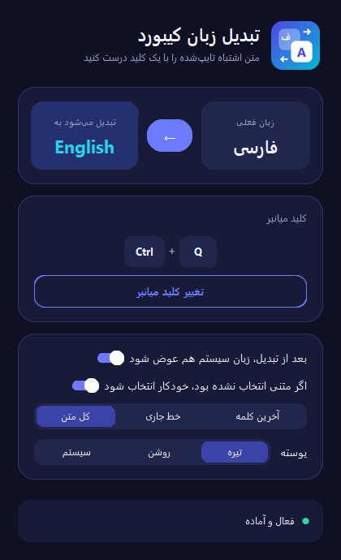
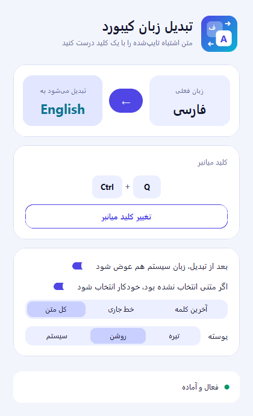

<div align="center">


# LayoutSwitcher

**متنِ اشتباه تایپ‌شده را با یک کلید میانبر درست کن.**

`سلام` ⇄ `sghl` — بدون کپی‌کردن، بدون بازکردن برنامه، بدون تایپ دوباره.

[](https://github.com/MM-8405/layout_switcher/releases/latest)
[](https://github.com/MM-8405/layout_switcher/releases)
[](#-نیازمندیها)
[](#-ساخت-از-سورس)
[](LICENSE)

<a href="https://github.com/MM-8405/layout_switcher/releases/latest">
  
</a>

</div>

---

<div align="center">

| 🌙 پوسته‌ی تیره | ☀️ پوسته‌ی روشن |
|:--:|:--:|
|  |  |

</div>

---

## 😩 مشکل چیه؟

می‌خوای «سلام» بنویسی، ولی یادت رفته زبان عوض کنی و این تایپ شده:

```text
sghl
```

طبق معمول: پاک کردن، عوض کردن زبان، تایپ دوباره. **LayoutSwitcher** این سه مرحله را به یک کلید کاهش می‌دهد.

## ✨ امکانات

| | امکان |
|:--:|:---|
| 🔁 | تبدیل دوطرفه‌ی چیدمان فارسی ⇄ انگلیسی با حفظ فاصله‌ها، عددها و علائم |
| ⌨️ | کلید میانبر پیش‌فرض `Ctrl + Alt + Space` — قابل تغییر از خود برنامه |
| 🖱️ | حالت‌های جایگزین: دوبار فشردن `Ctrl`/`Shift`/`Alt` یا دکمه‌ی کناری ماوس |
| 🎯 | انتخاب خودکار متن وقتی چیزی انتخاب نشده: کل متن / خط جاری / آخرین کلمه |
| 🌐 | تغییر خودکار زبان کیبورد سیستم به زبان مقصد بعد از تبدیل |
| 🎨 | پوسته‌ی روشن / تیره / هم‌گام با سیستم |
| 🧠 | تشخیص زبان نامشخص از روی خودِ متن (حدس بین فارسی و انگلیسی) |
| 💾 | ذخیره‌ی تنظیمات و یک‌نمونه‌ای بودن برنامه |
| 📦 | خروجی تک‌فایلی، **بدون نیاز به نصب پایتون** |

## ⬇️ دانلود و نصب

1. از صفحه‌ی [**Releases**](https://github.com/MM-8405/layout_switcher/releases/latest) فایل `LayoutSwitcher.exe` را دانلود کنید.
2. هرجایی که خواستید کپی کنید و دابل‌کلیک کنید — همین. نصب لازم نیست.
3. برنامه باز می‌ماند و با `Ctrl + Alt + Space` کار می‌کند (می‌توانید پنجره‌اش را مینیمایز کنید).

> **هشدار SmartScreen:** فایل امضای دیجیتال ندارد، پس ویندوز ممکن است هشدار بدهد.
> مسیر: **More info → Run anyway**.

## 🕹️ استفاده

| مرحله | کار |
|:--:|:---|
| ۱ | متن اشتباه را تایپ کنید (یا متنِ موجود را انتخاب کنید) |
| ۲ | `Ctrl + Alt + Space` را بزنید |
| ۳ | متن تبدیل می‌شود و جای متن قبلی می‌نشیند |

**مثال‌ها**

| تایپ کرده‌اید | می‌شود |
|:---|:---|
| `sghl` | `سلام` |
| `lsd` | `خب` |
| `v,kk` | `بهمن` |
| `سلام` | `sghl` |

### حالت‌های میانبر

| حالت | نحوه‌ی تنظیم | مناسب برای |
|:---|:---|:---|
| **ترکیب کلید** | «تغییر کلید میانبر» → کلید را بزنید | حالت پیش‌فرض و پایدار |
| **دوبار فشردن** | در حالت ثبت، دوبار `Ctrl`/`Shift`/`Alt` بزنید | بدون درگیر کردن کلیدهای دیگر |
| **دکمه‌ی ماوس** | در حالت ثبت، دکمه‌ی کناری ماوس را بزنید | میانبر تک‌دستی |

### تنظیمات

فایل `%APPDATA%\LayoutSwitcher\config.json`:

| کلید | مقدار پیش‌فرض | توضیح |
|:---|:---|:---|
| `mods` | `3` | ترکیب کلیدهای تغییردهنده (`Alt=1`, `Ctrl=2`, `Shift=4`) |
| `vk` | `32` | کد مجازی کلید اصلی (مثلاً `32` = Space) |
| `label` | `"Ctrl+Alt+Space"` | برچسب نمایشی میانبر |
| `type` | `"combo"` | نوع میانبر: `combo` / `double` / `mouse` |
| `switch_layout` | `true` | تغییر زبان سیستم بعد از تبدیل |
| `theme` | `"system"` | `system` / `light` / `dark` |
| `auto_select` | `true` | انتخاب خودکار متن |
| `auto_mode` | `"all"` | `all` / `line` / `word` |

## 🌍 زبان‌های پشتیبانی‌شده و افزودن زبان جدید

فعلاً **فارسی** و **انگلیسی**. در `layout_switcher.py`:

```python
KEYS = "qwertyuiop[]asdfghjkl;'zxcvbnm,./1234567890"

LAYOUTS = {
    "en": {"name": "English", "lang": 0x09, "chars": KEYS},
    "fa": {"name": "فارسی", "lang": 0x29, "chars": "ضصثقفغعهخحجچ..."},
}
```

- `lang` = کد زبان اصلی ویندوز (Primary Language ID): `en=0x09`، `fa=0x29`، `ar=0x01`، `ru=0x19` ...
- `chars` = کاراکتر هر کلید، هم‌طول و هم‌ترتیب با `KEYS`.
- `aliases` (اختیاری) = نگاشت حروف عربی/علائم جایگزین به کلید انگلیسی.

## 🛠️ ساخت از سورس

پیش‌نیاز: ویندوز + Python 3.10 یا بالاتر.

```bat
build.bat
```

اسکریپت وابستگی‌ها را نصب می‌کند، آیکون را از لوگو می‌سازد و `dist\LayoutSwitcher.exe` را تولید می‌کند.

یا به‌صورت دستی:

```bat
pip install -r requirements.txt pyinstaller
python layout_switcher.py --make-icon
pyinstaller --noconfirm --clean --onefile --noconsole --name LayoutSwitcher ^
  --icon assets\icon.ico --collect-all customtkinter layout_switcher.py
```

اجرای مستقیم بدون بیلد:

```bat
pip install -r requirements.txt
python layout_switcher.py
```

> هر بار که تگ `v*` پوش شود، [workflow](.github/workflows/release.yml) به‌صورت خودکار نسخه‌ی جدید را می‌سازد و به Releases ضمیمه می‌کند.

## 🗂️ ساختار پروژه

```
layout_switcher/
├─ layout_switcher.py          ← کد اصلی برنامه
├─ build.bat                   ← ساخت exe با یک دابل‌کلیک
├─ assets/
│  ├─ icon.ico                 ← آیکون (از لوگو ساخته می‌شود)
│  ├─ logo.png                 ← لوگو
│  ├─ screenshot-dark.png      ← تصویر پوسته‌ی تیره
│  └─ screenshot-light.png     ← تصویر پوسته‌ی روشن
├─ .github/workflows/
│  └─ release.yml              ← بیلد و انتشار خودکار
├─ requirements.txt            ← وابستگی‌ها
├─ CHANGELOG.md
├─ LICENSE
└─ README.md
```

## 🧩 چطور کار می‌کند؟

1. `RegisterHotKey` (یا polling سبک برای حالت‌های ماوس/دوبار-فشردن) کلید میانبر را می‌گیرد.
2. زبان پنجره‌ی فعال با `GetKeyboardLayout` تشخیص داده می‌شود و چیدمان مقصد از میان چیدمان‌های نصب‌شده انتخاب می‌شود.
3. متن با `Ctrl+Insert` کپی می‌شود (و در صورت نبود انتخاب، خودکار انتخاب می‌شود)، کاراکترها با جدول معکوس نگاشت می‌شوند و با `Shift+Insert` جای‌گذاری می‌شوند.
4. در پایان با `WM_INPUTLANGCHANGEREQUEST` زبان کیبورد سیستم تغییر می‌کند.

## 🩺 عیب‌یابی

| مشکل | راه‌حل |
|:---|:---|
| پیام «این کلید میانبر توسط برنامه‌ی دیگری استفاده می‌شود» | کلید میانبر دیگری انتخاب کنید |
| در بعضی برنامه‌ها کار نمی‌کند | آن برنامه کپی/چسباندن را مسدود کرده؛ یا با دسترسی Administrator اجرا شده — LayoutSwitcher را هم Run as administrator کنید |
| SmartScreen اجازه نمی‌دهد | More info → Run anyway |
| تنظیمات به حالت قبل برمی‌گردد | فایل `%APPDATA%\LayoutSwitcher\config.json` را پاک کنید تا از نو ساخته شود |
| چند نسخه باز نمی‌شود | عمدی است؛ فقط یک نمونه هم‌زمان اجرا می‌شود |

## 🗺️ نقشه‌ی راه

- [ ] پشتیبانی از چیدمان‌های بیشتر (عربی، روسی، …)
- [ ] میانبر اختصاصی برای هر زبان
- [ ] آیکون سینی سیستم (tray) و اجرای خودکار با ویندوز
- [ ] نسخه‌ی قابل‌حمل با فایل تنظیمات کنار exe

## 🤝 مشارکت

Issue و Pull Request خوش‌آمد است. برای تغییرات بزرگ‌تر اول یک Issue باز کنید تا هم‌راستا پیش برویم.

```bat
git clone https://github.com/MM-8405/layout_switcher.git
cd layout_switcher
pip install -r requirements.txt
python layout_switcher.py
```

## 📄 مجوز

این پروژه تحت مجوز [MIT](LICENSE) منتشر شده است.
